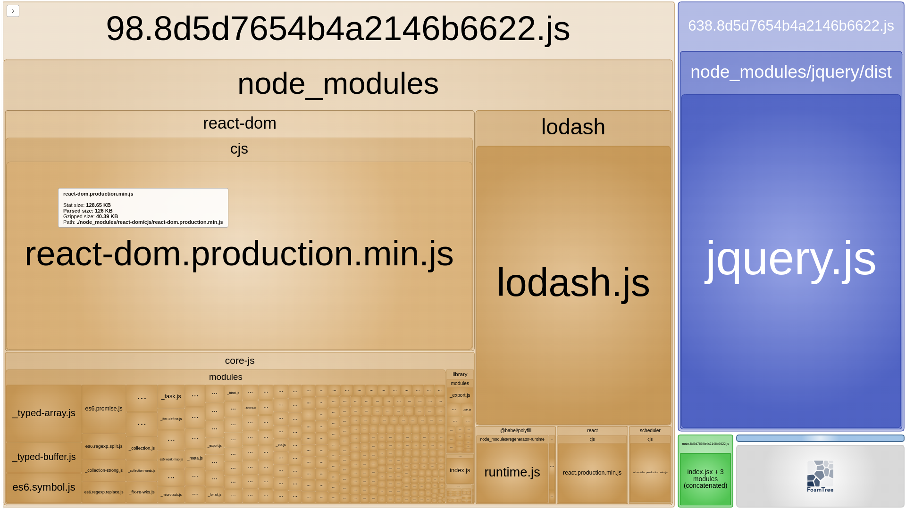

# vladilenMinin

**Credits & acknowledgments**

This project was coded line-by-line for practice and learning purposes, following the tutorial by [Vladilen Minin](https://www.youtube.com/@VladilenMinin).

**Author's school:** [result-university.com](https://result-university.com/)

## webpack-2020

- **Tutorial video:** [YouTube](https://www.youtube.com/watch?v=eSaF8NXeNsA)
- **Lesson assets:** [GitHub](https://github.com/vladilenm/webpack-2020)
- **Lesson assets:** [Local zip archive](data/webpack-2020-master.zip)

